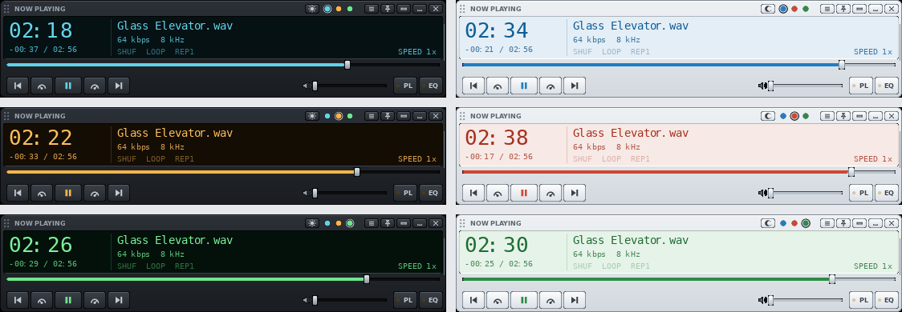
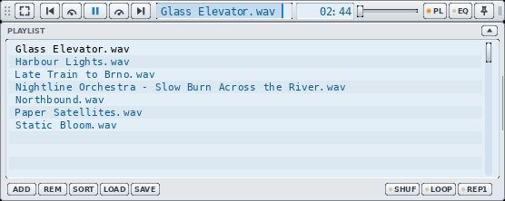

# Titlebar - a VLC skin

A music skin for VLC 3 (Windows and Linux, skins2 engine). The player collapses
into a 24 px strip that fits into a window title bar or the Windows taskbar.
Inspired by the MMD3 skin.


All screenshots are taken from real VLC 3.0.20 by `tools/doc-shots.sh`.

## Features

- **Strip**: expand, previous, slower, play / pause, faster, next, song title,
  time, volume, playlist, equalizer, always on top. Drag the grip on the left
  to move it, the right edge to make it wider.
- **Seek from the title**: the title window is also the seek bar. The played
  part fills it; click anywhere to jump there (the middle = 50 %), drag, or
  use the mouse wheel (5 % per notch).
- **Time**: elapsed time; click it for time left (and back). Fits tracks
  longer than an hour.

  

- **Playlist and equalizer** open attached to the player, with the same width.
  They open **below** the bar (for a title bar at the top of the screen) or
  **above** it (for the taskbar): the small arrow on the panel header flips the
  side. The bar does not move when panels open or close.

  | Below | Above |
  |---|---|
  |  |  |

- **Full player** (expand button): large time, title, bitrate, shuffle / loop /
  repeat-one, speed, seek bar, transport, volume, VLC's menu, minimize, quit.

  

- **Themes**: dark and light, each in three colours. Switch them in the full
  player's title bar: the sun / moon button toggles light and dark, the dots
  pick the colour.

  

- **Remembered**: VLC remembers the position, width, open panels, panel side,
  time mode and theme across restarts.
- **Taskbar mode** (Windows): a helper docks the strip in the taskbar, left of
  the Start button, and keeps it on top. See [Taskbar mode](#taskbar-mode).



## Install

### Windows (recommended)

1. Copy this folder somewhere permanent, for example `Documents\VLC-skin`.
   The setup points VLC at the skin file in it.
2. Close VLC and double-click **`taskbar\Setup.cmd`**. It:
   - picks the skin file for your display scaling (`Titlebar-100/125/150/200.vlt`);
   - makes VLC use the skin also when you double-click a file or folder in
     Explorer;
   - sends files you open to the running player (no second VLC window);
   - removes the "Media Library" entry from the playlist (it does nothing in
     a skin);
   - asks whether to start the helper with Windows. The helper pins the player
     on top each time VLC starts and, if you want, docks it in the taskbar.

   Your previous VLC settings are kept as `%APPDATA%\vlc\vlcrc.before-titlebar`.
3. Open a music file or folder.

**Undo**: close VLC, copy `vlcrc.before-titlebar` back over `vlcrc`, and
delete "Titlebar VLC helper" from the Startup folder (Win+R, `shell:startup`).

### Manual (any OS)

1. Pick the file for your display scaling: `Titlebar-100.vlt`,
   `Titlebar-125.vlt`, `Titlebar-150.vlt` or `Titlebar-200.vlt`.
2. VLC > Tools > Preferences > Interface > Look and feel: **Use custom skin**,
   choose the file, Save, restart VLC.

To go back to the normal VLC look: in the full player open the menu (≡) >
Interface > Preferences > **Use native style**, restart VLC.

## Using it

### Strip

| Control | What it does |
|---|---|
| Grip (dots, left) | Drag to move the player |
| Expand | Full player |
| Previous / next | Previous / next track |
| Speedometers | Slower / faster playback |
| Play / pause | |
| Title | Song name (scrolls when long). Click = jump to that point, drag = seek, wheel = 5 % |
| Time | Elapsed; click for time left |
| Volume | Slider |
| PL / EQ | Show / hide playlist / equalizer (lit when open) |
| Pin | Always on top (lit when on) |
| Right edge | Drag to change the width (the whole player follows) |

### Full player

Title bar: theme switcher (sun / moon and colour dots), VLC menu (≡: open
files, preferences, skins), pin, collapse back to the strip, minimize, quit.
Display: large time (click to switch elapsed / time left), the other value and
the total under it, title, bitrate and sample rate, SHUF / LOOP / REP1 toggles,
speed. Then the seek bar, transport, volume, PL and EQ.

### Playlist and equalizer

- Playlist: double-click a track to play it; ADD, REM (remove selected), SORT,
  LOAD, SAVE; SHUF / LOOP / REP1.
- Equalizer: ON switch, preamp and 10 bands.
- Arrow on the header: open both panels on the other side of the bar. After
  flipping, the bar is at the other end of the player's area, so drag it back
  once.
- Drag & drop files onto the player to play them.

### Keyboard

VLC's own shortcuts work while the player has focus, for example Space
(play / pause), Shift / Alt / Ctrl + arrow keys (jump 3 s / 10 s / 1 min),
Ctrl + up / down (volume).

## Taskbar mode

Windows 11 has no API to put a player *into* the taskbar, so a small helper
(`taskbar\`, PowerShell + C#) keeps VLC's strip positioned over it.

1. Free the space left of Start: Settings > Personalization > Taskbar >
   **Widgets: Off**.
2. Either run `Setup.cmd` and answer Yes to both questions (the helper starts
   with Windows and docks VLC whenever it runs, also when started from a
   file), or close VLC and double-click **`taskbar\VLC in taskbar.cmd`**
   (VLC with the skin, docked, for this session). A console window flashes
   briefly: that is PowerShell starting.
3. Flip the panels to open **above** once (arrow on the PL / EQ header).

What the helper does:

- Puts the strip in the taskbar, vertically centred, 8 px left of Start, and
  follows Start when taskbar icons shift. The full player sits just above
  the taskbar; PL / EQ stick out above.
- Pins VLC on top after it starts (it clicks the skin's pin, so the pin
  lights up; VLC itself always starts unpinned).
- Keeps the player above the taskbar after you click the taskbar, steps
  behind full-screen apps and comes back after.
- Tray icon (dark square with a cyan bar) with a right-click menu: **Dock in
  taskbar** (same as **Ctrl+Alt+Shift+V**), **Pin VLC on top now**, **Open
  debug log** (when the log is on), **Quit helper**. Windows may hide the
  icon under the `^` overflow until you drag it out.
- Quits when VLC quits, except when started with Windows: then it waits for
  the next VLC.

Settings are at the top of `taskbar\vlc-taskbar.ps1`: skin file (`auto` =
by display scaling), dock position (`start`, `left`, `right` = next to the
tray icons), gap, vertical nudge, start pinned, tray icon, debug log.

## Troubleshooting

| Problem | What to do |
|---|---|
| Double-clicking a file opens a second, normal VLC | Run `taskbar\Setup.cmd` (with VLC closed). |
| The player disappears when I click the taskbar | Make sure the helper runs (tray icon). If it still happens, turn the log on (below) and send `%TEMP%\titlebar-helper.log`. |
| Helper log | Change `$false` to `$true` on the `$DebugLog` line of `vlc-taskbar.ps1`, or run it with `-DebugLog`. Up to 1 MB, the older part in `titlebar-helper.log.old`. |
| The skin looks too small / too big | Use the file that matches Windows' display scaling (`Titlebar-150.vlt` for 150 %), or run Setup again. |
| Back to the normal VLC look | Menu (≡) > Interface > Preferences > Use native style, or the Undo steps above. |

## Limits

These come from VLC's skin engine (skins2); details in
[docs/architecture.md](docs/architecture.md) and [BACKLOG.md](BACKLOG.md):

- The playlist has a fixed height and shows one column (no duration column).
- No A-B loop, EQ presets or "next folder" buttons (skins2 has no such
  actions; options are in the backlog).
- Flipping the panel side moves the bar once.
- The player's invisible area does not snap to screen edges.
- Six themes cost memory: about 150 MB for VLC at 100 % scaling, 240 MB at 150 %.
- Windows only: the taskbar helper. The skin itself also works on Linux.

## Project files

| Path | What |
|---|---|
| `Titlebar-*.vlt` | The skin, one file per display scaling |
| `taskbar/` | Windows helper: `Setup.cmd`, `VLC in taskbar.cmd`, `vlc-taskbar.ps1`, `VlcDock.cs` |
| `source/build_skin.py` | Generator: draws every bitmap and writes the skin (Python 3 + Pillow) |
| `source/fonts/` | DejaVu fonts used by the generator and the skin |
| `tools/` | Test harness: real VLC under Xvfb, screenshots ([tools/README.md](tools/README.md)) |
| `docs/` | [Architecture](docs/architecture.md), [Lua API notes](docs/lua-api-notes.md), screenshots |
| `BACKLOG.md` | Wishlist, what is possible, agent task briefs |

## Building

```bash
python3 source/build_skin.py --scale 1.5 --width 556 --preview
```

`--scale` 1 / 1.25 / 1.5 / 2 matches the display scaling, `--width` the default
width in logical pixels (min 442), `--out` the output folder (default
`source/dist`), `--preview` also writes a PNG of all states. See
[docs/architecture.md](docs/architecture.md) for how the generator works.

## Credits

Font: DejaVu Sans Mono and DejaVu Sans Bold (license in
`source/fonts/LICENSE-DejaVu.txt`).
