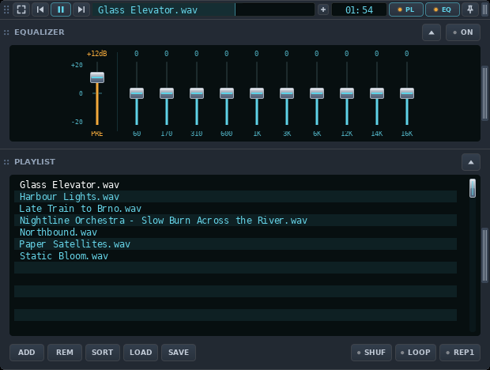
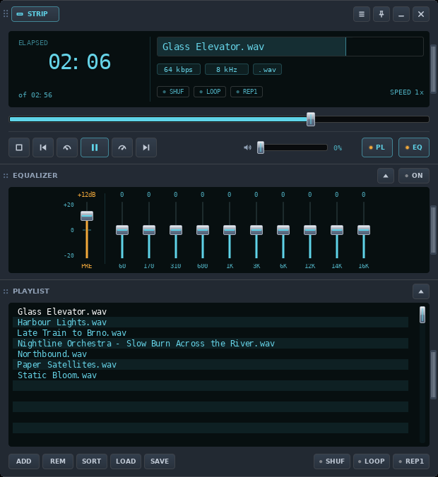

# VLC Amp

**A VLC 3 skin inspired by the Winamp and its beloved MMD3 skin, with a title bar mode.** The player collapses
into a slim 24 px strip that fits into a window's title bar (or the Windows taskbar), and expands
into a full player with equalizer and playlist. For Windows and Linux.

^^^^with the app yo can
^^^^light dark mode
^^^^configurator

**Download:**
[Windows (zip)](https://github.com/fakrij/vlc-amp/releases/latest/download/VLC-Amp-windows.zip)
·
[Linux (tar.gz)](https://github.com/fakrij/vlc-amp/releases/latest/download/VLC-Amp-linux.tar.gz)
· [all releases](https://github.com/fakrij/vlc-amp/releases)

**Your own colours, font and size:** the [online configurator](https://fakrij.github.io/vlc-amp/)
builds a `.vlt` skin in your browser.

## Screenshots

Strip with equalizer and playlist (they open below the bar, or above it for the taskbar):

Full player with equalizer and playlist:

The screenshots are taken from real VLC 3.0.20.

## Features

- **Strip**: previous, play / pause, next, song title, time, volume, playlist, equalizer,
  always on top. The title is also the seek bar: click, drag or use the mouse wheel.
- **Full player**: large time (elapsed or remaining), title, bitrate, sample rate, format,
  shuffle / loop / repeat one, speed, seek bar, transport and volume.
- **Playlist and equalizer** attached to the player, with the same width.
- **Video window** with its own control panel.
- **Taskbar mode** (Windows): a helper docks the strip in the taskbar and keeps it on top.
- **Lua extras**: A-B loop, next / previous folder, equalizer presets, playlist durations.
- **Media controls**: media keys and the system's media panel.
- VLC remembers the position, width, open panels and time mode.

## Install

- **Windows**: unpack the zip, close VLC and double-click `Install.cmd`. It installs VLC if
  it is missing, copies the skin and sets VLC up to use it.
- **Linux**: unpack the tar.gz somewhere permanent, close VLC and run `Install.sh`. Works
  with VLC from your distro, Flatpak or Snap.

The full guide (setup options, taskbar mode, extras, troubleshooting, limits and building
from source) is in [VLC-Amp/README.md](VLC-Amp/README.md).

## Support

VLC Amp is free. If you like it, you can
[buy me a coffee on Ko-fi](https://ko-fi.com/jirkafiala).
