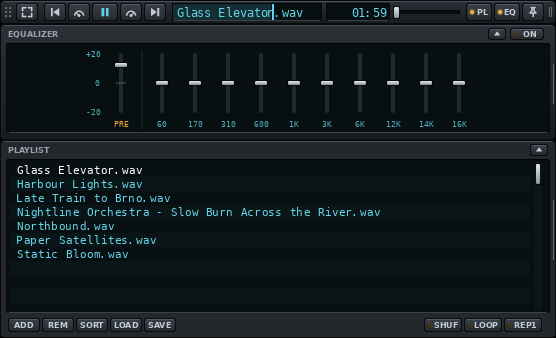
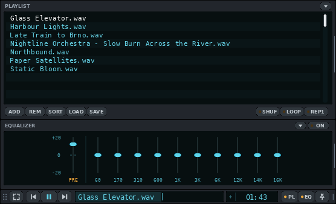
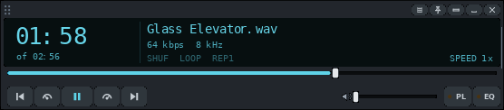

# Titlebar - a VLC skin

A music skin for VLC 3 (Windows and Linux, skins2 engine). The player collapses
into a 24 px strip that fits into a window title bar or the Windows taskbar.
Inspired by the MMD3 skin.


All screenshots are taken from real VLC 3.0.20 by `tools/doc-shots.sh`.

## Features

- **Strip**: expand, previous, slower, play / pause, faster, next, song title,
  time, volume, playlist, equalizer, always on top. Drag the grip on the left
  to move it, the right edge to make it wider.
- **Seek from the title**: the title window is also the seek bar. The played
  part fills it; click anywhere to jump there (the middle = 50 %), drag, or
  use the mouse wheel (5 % per notch).
- **Time**: elapsed time; click it for time left (and back). Fits tracks
  longer than an hour.

  

- **Playlist and equalizer** open attached to the player, with the same width.
  They open **below** the bar (for a title bar at the top of the screen) or
  **above** it (for the taskbar): the small arrow on the panel header flips the
  side. The bar does not move when panels open or close.

  | Below | Above |
  |---|---|
  |  |  |

- **Full player** (expand button): large time, title, bitrate, shuffle / loop /
  repeat-one, speed, seek bar, transport, volume, VLC's menu, minimize, quit.

  

- **Look**: Midnight (dark, cyan-blue). Every extra theme costs VLC memory, so
  the skin ships with this one only. Other colour schemes, a light look and a
  Custom colour can be built in (see [More themes](#more-themes)).

- **Remembered**: VLC remembers the position, width, open panels, panel side,
  time mode and theme across restarts.
- **Taskbar mode** (Windows): a helper docks the strip in the taskbar, left of
  the Start button, and keeps it on top. See [Taskbar mode](#taskbar-mode).
- **Lua extras**: A-B loop, next / previous folder, equalizer presets and a
  bitrate for FLAC, as keyboard shortcuts and (Windows) tray menu entries. See
  [Lua extras](#lua-extras).
- **Media controls**: keyboard media keys and the system's media panel show
  and control VLC. Windows: optional plugin, installed by Setup (see
  [Media controls](#media-controls)). Linux: built into VLC.

## Install

### Windows (recommended)

1. Copy this folder somewhere permanent, for example `Documents\VLC-skin`.
   The setup points VLC at the skin file in it.
2. Close VLC and double-click **`taskbar\Setup.cmd`**. It:
   - picks the skin file for your display scaling (`Titlebar-100/125/150/200.vlt`);
   - makes VLC use the skin also when you double-click a file or folder in
     Explorer;
   - sends files you open to the running player (no second VLC window);
   - removes the "Media Library" entry from the playlist (it does nothing in
     a skin);
   - asks whether to start the helper with Windows. The helper pins the player
     on top each time VLC starts and, if you want, docks it in the taskbar;
   - turns on VLC's built-in web interface for this computer only
     (`127.0.0.1`, port 48080, protected by a random password that is stored
     in `vlcrc`). The helper uses it to read what VLC is playing and to send
     commands; nothing is reachable from the network.
   - installs the Lua extras: copies `lua\intf\titlebar.lua` to `%APPDATA%\vlc\lua\intf\`,
     starts it with VLC and sets its default keys (see [Lua extras](#lua-extras));
   - asks whether to add Windows media controls (see [Media controls](#media-controls)).

   Your previous VLC settings are kept as `%APPDATA%\vlc\vlcrc.before-titlebar`.
3. Open a music file or folder.

**Undo**: close VLC, copy `vlcrc.before-titlebar` back over `vlcrc` (this also
switches the web interface, the Lua extras and the media controls off again), and delete
"Titlebar VLC helper" from the Startup folder (Win+R, `shell:startup`).
The media controls plugin can stay (VLC ignores it when it is not switched on)
or be deleted: `libwin10smtc_plugin.dll` in VLC's `plugins\misc` folder. `%APPDATA%\vlc\lua\intf\titlebar.lua` can stay too.

### Manual (any OS)

1. Pick the file for your display scaling: `Titlebar-100.vlt`,
   `Titlebar-125.vlt`, `Titlebar-150.vlt` or `Titlebar-200.vlt`.
2. VLC > Tools > Preferences > Interface > Look and feel: **Use custom skin**,
   choose the file, Save, restart VLC.

To go back to the normal VLC look: in the full player open the menu (≡) >
Interface > Preferences > **Use native style**, restart VLC.

## Using it

### Strip

| Control | What it does |
|---|---|
| Grip (dots, left) | Drag to move the player |
| Expand | Full player |
| Previous / next | Previous / next track |
| Speedometers | Slower / faster playback |
| Play / pause | |
| Title | Song name (scrolls when long). Click = jump to that point, drag = seek, wheel = 5 % |
| Time | Elapsed; click for time left |
| Volume | Slider |
| PL / EQ | Show / hide playlist / equalizer (lit when open) |
| Pin | Always on top (lit when on) |
| Right edge | Drag to change the width (the whole player follows) |

### Full player

Title bar: VLC menu (≡: open files, preferences, skins), pin, collapse back
to the strip, minimize, quit. A skin built with several themes also has a
round theme button there.
Display: large time (click to switch elapsed / time left), the track length
under it ("of 5:16"), title, bitrate and sample rate, SHUF / LOOP / REP1 toggles,
speed. Then the seek bar, transport, volume, PL and EQ.

### More themes

The generator has 10 more themes: dark Ember (amber), Forest (mint), Nord
(frost blue), Dusk (pink), Carbon (red); light Paper (white / grey, blue), Sand
(teal on cream), Sage (green), Rose (raspberry); and **Custom**, dark in any
colour you choose.
Each adds about 10 MB of VLC memory at 100 % scaling (20 MB at 150 %) and some
start-up time, so build only the ones you want (the first is the default):

```bash
python3 source/build_skin.py --scale 1.5 --themes "Midnight,Paper,Nord,Custom" --custom "#33ff99"
```

`--themes all` builds every theme (about 240 MB of VLC memory at 100 %).

**Custom colour.** A skin that contains Custom (built with it, as above) can
be recoloured later without the generator: the tool in `custom-colour/`
rewrites the `.vlt` files in this folder (close VLC first; it reads them at
start). Then restart VLC and pick Custom with the theme button.

- **Windows**: double-click **`custom-colour\Custom colour.cmd`**. A colour
  dialog opens (starting at the current accent), then every `Titlebar-*.vlt`
  next to the `custom-colour` folder is rewritten. Needs Windows 10 1803 or
  later (`tar.exe`); no admin rights.
- **Linux** (any distro, Python 3 only, nothing else to install):
  `python3 custom-colour/custom-colour.py` opens `zenity`, `kdialog`, `yad` or
  tkinter's colour chooser, whichever exists, else asks in the terminal.
  `python3 custom-colour/custom-colour.py "#33ff99"` skips the dialog;
  `--reset` returns to the default accent (`#b48cff`); more arguments are
  `.vlt` files to change instead of the default ones.

### Playlist and equalizer

- Playlist: double-click a track to play it; ADD, REM (remove selected), SORT,
  LOAD, SAVE; SHUF / LOOP / REP1.
- Equalizer: ON switch, preamp and 10 bands.
- Arrow on the header: open both panels on the other side of the bar. After
  flipping, the bar is at the other end of the player's area, so drag it back
  once.
- Drag & drop files onto the player to play them.

### Keyboard

VLC's own shortcuts work while the player has focus, for example Space
(play / pause), Shift / Alt / Ctrl + arrow keys (jump 3 s / 10 s / 1 min),
Ctrl + up / down (volume).

## Taskbar mode

Windows 11 has no API to put a player *into* the taskbar, so a small helper
(`taskbar\`, PowerShell + C#) keeps VLC's strip positioned over it.

1. Free the space left of Start: Settings > Personalization > Taskbar >
   **Widgets: Off**.
2. Either run `Setup.cmd` and answer Yes to both questions (the helper starts
   with Windows and docks VLC whenever it runs, also when started from a
   file), or close VLC and double-click **`taskbar\VLC in taskbar.cmd`**
   (VLC with the skin, docked, for this session). A console window flashes
   briefly: that is PowerShell starting.
3. Flip the panels to open **above** once (arrow on the PL / EQ header).

What the helper does:

- Puts the strip in the taskbar, vertically centred, 8 px left of Start, and
  follows Start when taskbar icons shift. The full player sits just above
  the taskbar; PL / EQ stick out above.
- Pins VLC on top after it starts (it clicks the skin's pin, so the pin
  lights up; VLC itself always starts unpinned).
- Keeps the player above the taskbar after you click the taskbar, steps
  behind full-screen apps and comes back after.
- Tray icon (dark square with a cyan bar) with a right-click menu: **Dock in
  taskbar** (same as **Ctrl+Alt+Shift+V**), **Pin VLC on top now**, **Playback**
  (A-B loop, next / previous folder, next EQ preset; see [Lua extras](#lua-extras)),
  **Open debug log** (when the log is on), **Quit helper**. Windows may hide the
  icon under the `^` overflow until you drag it out.
- Quits when VLC quits, except when started with Windows: then it waits for
  the next VLC.

Settings are at the top of `taskbar\vlc-taskbar.ps1`: skin file (`auto` =
by display scaling), dock position (`start`, `left`, `right` = next to the
tray icons), gap, vertical nudge, start pinned, tray icon, debug log.

## Lua extras

VLC's skin engine cannot give a skin these features, so a small Lua script,
`lua/intf/titlebar.lua`, runs inside VLC next to the skin (Windows and Linux).
Windows: `Setup.cmd` installs it. Linux and by hand: copy it to
`~/.local/share/vlc/lua/intf/` (Windows: `%APPDATA%\vlc\lua\intf\`) and add
`luaintf` to `extraintf` and `lua-intf=titlebar` to `vlcrc` (details in
[docs/architecture.md](docs/architecture.md#lua-interface-luaintftitlebarlua)).
VLC must have its Lua support (the normal Windows and distribution builds do).

| Feature | Default key (player has focus) | Tray menu (Windows) |
|---|---|---|
| **A-B loop**: first press sets A, second sets B and plays A-B in a loop, third clears | `Ctrl+Shift+A` | Playback > A-B loop |
| **Next folder**: jumps to the first track of the next folder in the playlist | `Ctrl+Shift+Right` | Playback > Next folder |
| **Previous folder**: start of the previous folder | `Ctrl+Shift+Left` | Playback > Previous folder |
| **Next / previous equalizer preset** (turns the equalizer on; the EQ panel follows) | `Ctrl+Shift+Up` / `Down` | Playback > Next EQ preset |
| **Bitrate for FLAC** and other lossless files (shown by the full player; VLC shows none) | automatic | |

- Folders are the directories of local files; streams are skipped. A folder
  must be in one piece in the playlist.
- The A-B loop turns about 0.2 s after B, and stops when the track changes.
  The skin has no place to show the loop or preset name; they are written to
  VLC's log (start VLC with `-v`). The EQ panel shows the preset's sliders.
- The sample rate keeps showing whole kHz ("44" for 44.1 kHz): that is how
  VLC's skin engine formats it.
- Change the keys in VLC: Tools > Preferences > All > Hotkeys (or `vlcrc`).
  The script uses five VLC actions that do nothing for music, so keep these
  names: A-B loop = *Sync subtitle (mark audio)*, next / previous folder =
  *Roll clockwise / anticlockwise* (viewpoint), next / previous preset =
  *Zoom in / out* (viewpoint). Their `global-key-...` options make them
  work when VLC is not focused (not set by default).
- Any program can trigger them through VLC's web interface:
  `requests/status.json?command=key&val=subsync-markaudio` (also
  `viewpoint-roll-clock`, `viewpoint-roll-anticlock`, `viewpoint-fov-in`,
  `viewpoint-fov-out`). The helper's tray menu does that.
- Keys in the skin need VLC's Qt plugin (standard on Windows and in the
  normal Linux packages).

## Media controls

**Windows.** VLC 3 does not talk to Windows' media controls by itself. Setup
can add the free third-party plugin
[vlc-win10smtc](https://github.com/spmn/vlc-win10smtc) (GPL-3.0, version
v5.0.0). With it, the keyboard's media keys, the media panel that appears with
the volume, the media card in Quick Settings and the lock screen show the
title and control VLC. Setup:

- downloads the plugin that matches VLC (64-bit, 32-bit or ARM) from GitHub
  and checks its SHA-256 checksum;
- if needed, offers to install Microsoft's Visual C++ runtime, which the
  plugin requires (downloaded from Microsoft, signature checked);
- asks for admin rights once to copy `libwin10smtc_plugin.dll` into
  `<VLC folder>\plugins\misc`;
- switches it on in VLC (`extraintf=win10smtc`).

By hand: download the zip for your VLC from the plugin's releases page, copy
the DLL into `plugins\misc`, then in VLC: Tools > Preferences > All >
Interface > Control interfaces > tick **Windows SMTC integration** > Save.

**Linux.** Built into VLC (MPRIS over D-Bus), nothing to install: the
desktop's media widget, media keys and `playerctl` control the skinned player.
Tested with this skin.

## Troubleshooting

| Problem | What to do |
|---|---|
| Double-clicking a file opens a second, normal VLC | Run `taskbar\Setup.cmd` (with VLC closed). |
| The player disappears when I click the taskbar | Make sure the helper runs (tray icon). If it still happens, turn the log on (below) and send `%TEMP%\titlebar-helper.log`. |
| Helper log | Change `$false` to `$true` on the `$DebugLog` line of `vlc-taskbar.ps1`, or run it with `-DebugLog`. Up to 1 MB, the older part in `titlebar-helper.log.old`. |
| The skin looks too small / too big | Use the file that matches Windows' display scaling (`Titlebar-150.vlt` for 150 %), or run Setup again. |
| Media keys do nothing / VLC is missing from the Windows media panel | Run Setup again and answer Yes to media controls. Check that `libwin10smtc_plugin.dll` is in VLC's `plugins\misc` folder and that `extraintf` in `vlcrc` contains `win10smtc`. |
| Back to the normal VLC look | Menu (≡) > Interface > Preferences > Use native style, or the Undo steps above. |

## Limits

These come from VLC's skin engine (skins2); details in
[docs/architecture.md](docs/architecture.md) and [BACKLOG.md](BACKLOG.md):

- The playlist has a fixed height and shows one column (no duration column).
- No A-B loop, EQ presets or "next folder" *buttons* (skins2 has no such
  actions): they are keyboard shortcuts and tray menu entries, see
  [Lua extras](#lua-extras).
- Flipping the panel side moves the bar once.
- The player's invisible area does not snap to screen edges.
- Memory: VLC with this skin uses about 136 MB at 100 % scaling and 146 MB at
  150 % (Linux RSS; VLC's own default skin: 131 MB). About 100 MB of that is
  VLC itself. Every extra theme adds about 10 MB at 100 % (20 MB at
  150 %), see [More themes](#more-themes).
- Windows only: the taskbar helper. The skin itself also works on Linux.

## Project files

| Path | What |
|---|---|
| `Titlebar-*.vlt` | The skin, one file per display scaling |
| `lua/intf/titlebar.lua` | Lua interface: A-B loop, folder jump, EQ presets, bitrate for lossless files |
| `taskbar/` | Windows helper: `Setup.cmd`, `VLC in taskbar.cmd`, `vlc-taskbar.ps1`, `VlcDock.cs` |
| `source/build_skin.py` | Generator: draws every bitmap and writes the skin (Python 3 + Pillow) |
| `source/fonts/` | DejaVu fonts used by the generator and the skin |
| `custom-colour/` | Pick the Custom theme's accent colour: `Custom colour.cmd` + `custom-colour.ps1` (Windows), `custom-colour.py` (Linux / any Python 3) |
| `tools/` | Test harness: real VLC under Xvfb, screenshots ([tools/README.md](tools/README.md)) |
| `docs/` | [Architecture](docs/architecture.md), [Lua API notes](docs/lua-api-notes.md), screenshots |
| `BACKLOG.md` | Wishlist, what is possible, agent task briefs |

## Building

```bash
python3 source/build_skin.py --scale 1.5 --width 556 --preview
```

`--scale` 1 / 1.25 / 1.5 / 2 matches the display scaling, `--width` the default
width in logical pixels (min 442), `--out` the output folder (default
`source/dist`), `--preview` also writes a PNG of all states, `--themes` picks
the themes (comma-separated, the first one is the default; `all` = every
theme; default `Midnight`), and
`--custom #rrggbb` sets the Custom theme's colour. See
[docs/architecture.md](docs/architecture.md) for how the generator works.

## Credits

Font: DejaVu Sans Mono and DejaVu Sans Bold (license in
`source/fonts/LICENSE-DejaVu.txt`).
