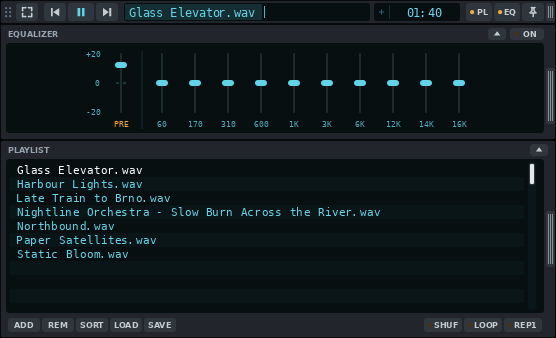
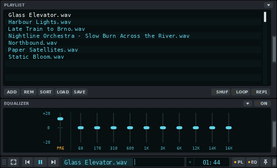
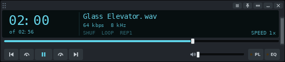

# Titlebar - a VLC skin

A music skin for VLC 3 (Windows and Linux, skins2 engine). The player collapses
into a 24 px strip that fits into a window title bar or the Windows taskbar.
Inspired by the MMD3 skin.


The skin screenshots are taken from real VLC 3.0.20 by `tools/doc-shots.sh`;
the Windows comparison images in `docs/img/windows-sim/` come from
`tools/windows-sim.py`.

## Features

- **Strip**: expand, previous, play / pause, next, song title,
  time, volume, playlist, equalizer, always on top. Drag the grip on the left
  to move it, the right edge to make it wider.
- **Seek from the title**: the title window is also the seek bar. The played
  part fills it; click anywhere to jump there (the middle = 50 %), drag, or
  use the mouse wheel (5 % per notch).
- **Time**: elapsed time; click it for time left (and back). Fits tracks
  longer than an hour.

  

- **Playlist and equalizer** open attached to the player, with the same width.
  They open **below** the bar (for a title bar at the top of the screen) or
  **above** it (for the taskbar): the small arrow on the panel header flips the
  side. The bar does not move when panels open or close.

  | Below | Above |
  |---|---|
  |  |  |

- **Full player** (expand button): large time, title, bitrate, shuffle / loop /
  repeat-one, speed, seek bar, transport, volume, VLC's menu, minimize, quit.

  

- **Look**: Midnight (dark, cyan-blue). Every extra theme costs VLC memory, so
  the skin ships with this one only. Other colour schemes, a light look and a
  Custom colour can be built in (see [More themes](#more-themes)).

- **Remembered**: VLC remembers the position, width, open panels, panel side,
  time mode and theme across restarts.
- **Taskbar mode** (Windows): a helper docks the strip in the taskbar, left of
  the Start button, and keeps it on top. See [Taskbar mode](#taskbar-mode).
- **Lua extras**: A-B loop, next / previous folder, equalizer presets and a
  bitrate for FLAC, as keyboard shortcuts and (Windows) tray menu entries. See
  [Lua extras](#lua-extras).
- **Media controls**: keyboard media keys and the system's media panel show
  and control VLC. Windows: optional plugin, installed by Setup (see
  [Media controls](#media-controls)). Linux: built into VLC.

## Install

### Windows (recommended)

1. Close VLC and double-click **`Install.cmd`** (in this folder, or in the
   `Titlebar-VLC-skin-windows` folder built by `tools/make-windows-package.sh`).
   It:
   - installs VLC 3 with `winget` if it is missing;
   - copies the skin to `%LOCALAPPDATA%\Titlebar-VLC-skin` (VLC points at the
     skin file there, so the folder you started from can be deleted);
   - runs the setup (`taskbar\vlc-taskbar.ps1 -Setup`), see below;
   - adds Start menu entries (Titlebar VLC skin): **VLC (Titlebar)**, setup
     again, VLC in taskbar, uninstall, skin folder.
2. Open a music file or folder.

The setup:
- picks the skin file for your display scaling (`Titlebar-100/125/150/200.vlt`;
  if you let the helper dock the player in the taskbar, the taller
  `Titlebar-taskbar-NNN.vlt`, see [Taskbar mode](#taskbar-mode));
- makes VLC use the skin also when you double-click a file or folder in
  Explorer, and sends files you open to the running player (no second VLC
  window);
- removes the "Media Library" entry from the playlist (it does nothing in a
  skin). `media-library=0` in `vlcrc` is not enough on Windows either: VLC's
  launcher (`vlc.exe`) puts `--media-library` before your own arguments, so
  the setup also adds `--no-media-library` (a later argument wins) to the
  commands Explorer uses for VLC's file types and the folder / audio CD / DVD
  entries (per-user registry keys under `HKCU\Software\Classes`, listed in
  `%LOCALAPPDATA%\Titlebar-VLC-skin\file-associations.txt`, no admin needed;
  your choice of default app is not changed), to the helper's own VLC start,
  and to the Start menu entry **VLC (Titlebar)**;
- asks whether to start the helper with Windows. The helper pins the player
  on top each time VLC starts, gives VLC a taskbar button with previous /
  play / next on hover and, if you want, docks it in the taskbar;
- turns on VLC's built-in web interface for this computer only (`127.0.0.1`,
  port 48080, protected by a random password stored in `vlcrc`). The helper
  uses it to read what VLC is playing and to send commands; nothing is
  reachable from the network;
- installs the Lua extras (`%APPDATA%\vlc\lua\intf\titlebar.lua`, its default
  keys; see [Lua extras](#lua-extras));
- asks whether to add Windows media controls (see [Media controls](#media-controls)).

Your previous VLC settings are kept as `%APPDATA%\vlc\vlcrc.before-titlebar`.

**Undo**: Start menu > Titlebar VLC skin > **Uninstall Titlebar skin** (or
`Uninstall.cmd`). It restores `vlcrc.before-titlebar` (keeping your last
settings as `vlcrc.titlebar-removed`), stops the helper, removes its Startup
shortcut, the Lua script, the Start menu entries, the registry keys listed in
`file-associations.txt` (only if they still have `--no-media-library`) and the
installed folder, and offers to remove the media controls plugin. VLC stays
installed.

### Linux (any distro)

Works with VLC from your distro's package, Flatpak (`org.videolan.VLC`) or
Snap, on any desktop. Tested on X11 with a distro package (VLC 3.0.20 under
Xvfb); Flatpak, Snap and Wayland (XWayland) are not tested yet. The script
needs only a POSIX shell and the usual tools (`awk`, `sed`, `grep`).

1. Copy this folder somewhere permanent, for example `~/VLC-skin` (the setup
   points VLC at the skin file in it; for a Snap VLC it must be under your home
   folder, not in a hidden folder).
2. Close VLC and run **`linux/setup.sh`** (`sh linux/setup.sh` if it is not
   executable). It:
   - finds VLC (package, Flatpak or Snap; asks if there are several) and its
     settings file (`vlcrc`);
   - picks the skin file for your display scaling and prints what it detected
     (`GDK_SCALE`, `QT_SCALE_FACTOR`, `Xft.dpi`, KDE and GNOME settings);
     `--scale 150` overrides it;
   - makes VLC use the skin also when you open a file or folder from the file
     manager, and send it to the running player (no second window);
   - adds a launcher **"VLC (Titlebar)"** to your applications menu
     (`~/.local/share/applications/vlc-titlebar.desktop`, a copy of VLC's with
     `--no-media-library`). Reason: the `vlc` program always adds
     `--media-library` itself, which beats the setting in `vlcrc`, so only
     this launcher removes the useless "Media Library" entry from the
     playlist. It offers to make the launcher the default app for audio files
     (`--default-player` / `--no-default-player` skip the question);
   - turns on VLC's built-in web interface for this computer only
     (`127.0.0.1`, port 48080, random password in `vlcrc`). Nothing on Linux
     uses it yet; `--no-web` leaves it off;
   - offers to start VLC pinned (always on top) at every login, with
     `linux/titlebar-pin.py` (`--pin-autostart` / `--no-pin-autostart`; only when
     that file and `python3` exist). It points at the file's place in this
     folder: run the setup again if you move the folder.

   Your previous VLC settings are kept as `vlcrc.before-titlebar` next to
   `vlcrc` (`~/.config/vlc/` for the package, `~/.var/app/org.videolan.VLC/config/vlc/`
   for Flatpak, `~/snap/vlc/common/` for Snap). The script refuses to run while
   VLC is running: VLC rewrites its settings when it exits.
3. Open a music file or folder with **VLC (Titlebar)**.

Other options: `--yes` (answers yes to every question), `--vlc native|flatpak|snap` (which VLC),
`--help`. Starting plain `vlc` from a terminal still shows the Media Library
entry; run `vlc --no-media-library` there.

**Undo**: `linux/setup.sh --uninstall` (VLC closed) puts `vlcrc` back, removes
the launcher and the start-pinned autostart, and gives back the default app
for audio files. Details and the
list of settings: [docs/architecture.md](docs/architecture.md#the-linux-setup-linuxsetupsh).

### Manual (any OS)

1. Pick the file for your display scaling: `Titlebar-100.vlt`,
   `Titlebar-125.vlt`, `Titlebar-150.vlt` or `Titlebar-200.vlt`.
2. VLC > Tools > Preferences > Interface > Look and feel: **Use custom skin**,
   choose the file, Save, restart VLC.

To go back to the normal VLC look: in the full player open the menu (≡) >
Interface > Preferences > **Use native style**, restart VLC.

## Using it

### Strip

| Control | What it does |
|---|---|
| Grip (dots, left) | Drag to move the player |
| Expand | Full player |
| Previous / next | Previous / next track |
| Play / pause | |
| Title | Song name (scrolls when long). Click = jump to that point, drag = seek, wheel = 5 % |
| Time | Elapsed; click for time left |
| Volume | Slider |
| PL / EQ | Show / hide playlist / equalizer (lit when open) |
| Pin | Always on top (lit when on) |
| Right edge | Drag to change the width (the whole player follows) |

### Full player

Title bar: VLC menu (≡: open files, preferences, skins), pin, collapse back
to the strip, minimize, quit. A skin built with several themes also has a
round theme button there.
Display: large time (click to switch elapsed / time left), the track length
under it ("of 5:16"), title, bitrate and sample rate, SHUF / LOOP / REP1 toggles,
speed. Then the seek bar, transport, volume, PL and EQ.

### Playlist and equalizer

- Playlist: double-click a track to play it; ADD, REM (remove selected), SORT,
  LOAD, SAVE; SHUF / LOOP / REP1.
- Equalizer: ON switch, preamp and 10 bands.
- Arrow on the header: open both panels on the other side of the bar. After
  flipping, the bar is at the other end of the player's area, so drag it back
  once (on Windows the taskbar helper moves it back for you).
- Drag & drop files onto the player to play them.

### Keyboard

VLC's own shortcuts work while the player has focus, for example Space
(play / pause), Shift / Alt / Ctrl + arrow keys (jump 3 s / 10 s / 1 min),
Ctrl + up / down (volume).

## Extras

### Lua extras

VLC's skin engine cannot give a skin these features, so a small Lua script,
`lua/intf/titlebar.lua`, runs inside VLC next to the skin (Windows and Linux).
Windows: `Setup.cmd` installs it. Linux and by hand: copy it to
`~/.local/share/vlc/lua/intf/` (Windows: `%APPDATA%\vlc\lua\intf\`) and add
`luaintf` to `extraintf` and `lua-intf=titlebar` to `vlcrc` (details in
[docs/architecture.md](docs/architecture.md#lua-interface-luaintftitlebarlua)).
VLC must have its Lua support (the Windows build and the Ubuntu 24.04 package
do; other distributions are not checked).

| Feature | Default key (player has focus) | Tray menu (Windows) |
|---|---|---|
| **A-B loop**: first press sets A, second sets B and plays A-B in a loop, third clears | `Ctrl+Shift+A` | Playback > A-B loop |
| **Next folder**: jumps to the first track of the next folder in the playlist | `Ctrl+Shift+Right` | Playback > Next folder |
| **Previous folder**: start of the previous folder | `Ctrl+Shift+Left` | Playback > Previous folder |
| **Next / previous equalizer preset** (turns the equalizer on; the EQ panel follows) | `Ctrl+Shift+Up` / `Down` | Playback > Next EQ preset |
| **Bitrate for FLAC** and other lossless files (shown by the full player; VLC shows none) | automatic | |

- Folders are the directories of local files; streams are skipped. A folder
  must be in one piece in the playlist.
- The A-B loop turns about 0.2 s after B, and stops when the track changes.
  The skin has no place to show the loop or preset name; they are written to
  VLC's log (start VLC with `-v`). The EQ panel shows the preset's sliders.
- The sample rate keeps showing whole kHz ("44" for 44.1 kHz): that is how
  VLC's skin engine formats it.
- The default keys live in `lua/vlcrc-keys.txt`; both setups write them into
  `vlcrc` unless you already set the action.
- Change the keys in VLC: Tools > Preferences > All > Hotkeys (or `vlcrc`).
  The script uses five VLC actions that do nothing for music, so keep these
  names: A-B loop = *Sync subtitle (mark audio)*, next / previous folder =
  *Roll clockwise / anticlockwise* (viewpoint), next / previous preset =
  *Zoom in / out* (viewpoint). Their `global-key-...` options make them
  work when VLC is not focused (not set by default).
- Any program can trigger them through VLC's web interface:
  `requests/status.json?command=key&val=subsync-markaudio` (also
  `viewpoint-roll-clock`, `viewpoint-roll-anticlock`, `viewpoint-fov-in`,
  `viewpoint-fov-out`). The helper's tray menu does that.
- Keys in the skin need VLC's Qt plugin (standard on Windows and in the
  normal Linux packages).

### Taskbar mode

Windows 11 has no API to put a player *into* the taskbar, so a small helper
(`taskbar\`, PowerShell + C#) keeps VLC's strip positioned over it.

1. Free the space left of Start: Settings > Personalization > Taskbar >
   **Widgets: Off**.
2. Either run `Setup.cmd` and answer Yes to both questions (the helper starts
   with Windows and docks VLC whenever it runs, also when started from a
   file), or close VLC and double-click **`taskbar\VLC in taskbar.cmd`**
   (VLC with the skin, docked, for this session). A console window flashes
   briefly: that is PowerShell starting.
3. The panels (PL / EQ) open **above** the docked strip. If they are set to open
   below (off the screen), the helper clicks the flip arrow on their header for you.

**Taller strip.** The taskbar is 48 px tall, so the 24 px strip looks small
there.


The folder has a second set of files, `Titlebar-taskbar-100/125/150/200.vlt`,
with a 36 px strip (bigger buttons and text; same width layout,
the full player, EQ and playlist are unchanged). When you answer Yes to "dock in
the taskbar", Setup picks this file, and so does `VLC in taskbar.cmd`; without
docking (and for a title bar) the normal 24 px file is used. The helper reads
the strip height from the file name (`taskbar` = 36, `bar40` = 40) and
positions the strip and its pin click with it. For another height, build it
(32-40 is sensible, the taskbar is 48):

```bash
python3 source/build_skin.py --scale 1.5 --bar-height 40     # Titlebar-bar40-150.vlt
```

copy the file (from `source/dist`) next to the other `.vlt` files, set `$Skin = "Titlebar-bar40-150.vlt"` at the top of `taskbar\vlc-taskbar.ps1`
(the file name tells the helper the height; `auto` only looks for the 36 px
`Titlebar-taskbar-NNN.vlt`) and run Setup again.

What the helper does:

- Puts the strip in the taskbar, vertically centred, 8 px left of Start, and
  follows Start when taskbar icons shift. The full player sits just above
  the taskbar; PL / EQ stick out above.
- Pins VLC on top after it starts (it clicks the skin's pin, so the pin
  lights up; VLC itself always starts unpinned).
- Keeps the player above the taskbar after you click the taskbar, steps
  behind full-screen apps and comes back after. The strip in the taskbar always
  stays on top of the taskbar (else the taskbar would hide it); the pin decides
  for the full player: unpinned, other windows can cover it.
- Moves the player by dragging it by its grip, the way you would, so VLC knows
  where it is and does not jump when you expand, collapse or resize it. It
  never moves it while you hold a mouse button. Docked next to Start, the right
  edge stays at Start: drag the right edge to make the strip wider, and when you
  let go it slides left so the right edge is back next to Start.
- Keeps the bar where it is when you flip the panels (the arrow on the PL / EQ
  header). Docked, the strip stays in the taskbar; not docked (`-NoDock`, or
  docking off with Ctrl+Alt+Shift+V), the window moves by the panels' height so
  the bar does not jump, but never off the screen.
- Keeps the docked player visible: if Windows minimizes VLC (it then shows only
  through VLC's tray icon), the helper restores it at once. The full player's
  own minimize button still works: VLC then stays minimized until you click its
  taskbar button or its tray icon. Not docked, the helper leaves minimizing alone.
- Tray icon (dark square with a cyan bar) with a right-click menu: **Dock in
  taskbar** (same as **Ctrl+Alt+Shift+V**), **Pin VLC on top now**, **Play /
  pause** and **Playback** (A-B loop, next / previous folder, next EQ preset;
  see [Lua extras](#lua-extras); the last two need the web interface),
  **Open debug log** (when the log is on), **Quit helper**. Windows may hide the
  icon under the `^` overflow until you drag it out.
- **Taskbar button** for VLC (needs the web interface that Setup turns on):
  hovering it shows **previous, play / pause and next** buttons and a preview
  with title, artist and time; the button fills green with the track's
  progress (yellow while paused); clicking it brings the player to the front,
  also back from minimized; "Close window" quits VLC. VLC's own button
  (which has none of this) is hidden. It belongs to the helper, so it is gone
  while the helper is not running. Off: `$TaskbarButton = $false`, then run
  Setup again.
- Quits when VLC quits, except when started with Windows: then it waits for
  the next VLC.

Settings are at the top of `taskbar\vlc-taskbar.ps1`: skin file (`auto` =
by display scaling, and the taller taskbar build when docking), dock position
(`start`, `left`, `right` = next to the tray icons), gap, vertical nudge, start
pinned, flipping the panels above the docked strip, tray icon, taskbar button (and its taskbar group, `$TaskbarAppId`),
debug log.

### Linux: pin on start

VLC never remembers "always on top", so it starts unpinned. On Linux a small
script does what the Windows helper does: it clicks the skin's own pin button
once after VLC's window appears, so the pin lights up. It needs only
`python3` (standard library; it talks to X11 through libX11, which VLC's skin
needs anyway), no `xdotool`. It does not move your mouse pointer.

```bash
linux/titlebar-pin.py                        # once: wait for VLC's window, pin it, exit
linux/titlebar-pin.py --watch &              # stay in the background, pin every new VLC
linux/titlebar-pin.py --install-autostart    # run --watch at every login
linux/titlebar-pin.py --uninstall-autostart  # undo that
```

`--install-autostart` writes `~/.config/autostart/titlebar-pin.desktop`
(XDG autostart: GNOME, KDE Plasma, XFCE, Cinnamon, MATE, LXQt and others). The
entry points at the script where it is now, so run it again if you move the
folder. The watcher looks at the process list every 2 seconds, opens no
connection to the display while VLC is not running, and pins each VLC start
once; a pin you remove by hand stays removed. Options: `-v` (say what it does),
`--dry-run` (print where the pin is, do not click), `--timeout`, `--scale`,
`--display`.

It works with the player collapsed or open, the bar at the top or bottom, and
every shipped scaling (tested under Xvfb so far, not on a real desktop). On Wayland, VLC's skin runs through XWayland and the
script talks to that X server, so it should work the same (tested only on X11
so far, see the Wayland checklist in [BACKLOG.md](BACKLOG.md)); it never places
or moves windows (Wayland does not allow that for other programs).

Whether the desktop keeps the player above other windows once pinned depends on
the window manager honouring `_NET_WM_STATE_ABOVE`, as most X11 window managers
do (the Wayland compositors' XWayland support is in the same checklist).
Without one the pin lights up but nothing stacks differently.
If the pin does not light, run the script with
`-v` and see [docs/architecture.md](docs/architecture.md#linux-pin-on-start).

### Linux: follow the system's light / dark setting (prototype)

For a skin built with two themes, one dark and one light (for example
`python3 source/build_skin.py --themes midnight,paper --out /tmp/skin`),
`linux/follow-system-theme.sh` starts VLC with the theme that matches the
system's colour scheme. skins2 cannot read the setting itself, but VLC saves
which theme is shown in the `skins2-config` line of `vlcrc` and reads it at
start, so the script rewrites that (th0 / th1) **only while VLC is not
running**, then starts VLC. It reads the setting from the XDG desktop portal
(`gdbus call ... org.freedesktop.appearance color-scheme`), else
`gsettings get org.gnome.desktop.interface color-scheme`; no answer or "no
preference" counts as dark.

```bash
linux/follow-system-theme.sh [vlc arguments]   # set the theme, then run vlc
linux/follow-system-theme.sh --install         # wrap the Exec lines of "VLC (Titlebar)" (made by linux/setup.sh)
linux/follow-system-theme.sh --uninstall       # undo that
linux/follow-system-theme.sh --check           # print dark or light
```

`--dark-theme N` / `--light-theme N` say which theme is which (default th0 =
dark, th1 = light, the order of `--themes`). If VLC is already running (for
example a file opened from the file manager goes to the running player) the
script leaves the settings alone and just starts VLC; it never stops VLC. The
theme is chosen at VLC's start: if the system switches while VLC runs, use the
theme button, the next start follows the system. The very first start, before
VLC has ever saved `skins2-config`, shows th0; quit VLC once. Moving the
folder needs `--install` again. Tested under Xvfb with a stub `gdbus`; real
portal and gsettings answers, Flatpak and Snap are not tested.

### Media controls

**Windows.** VLC 3 does not talk to Windows' media controls by itself. Setup
can add the free third-party plugin
[vlc-win10smtc](https://github.com/spmn/vlc-win10smtc) (GPL-3.0, version
v5.0.0). With it, the keyboard's media keys, the media panel that appears with
the volume, the media card in Quick Settings and the lock screen show the
title and control VLC. Setup:

- downloads the plugin that matches VLC (64-bit, 32-bit or ARM) from GitHub
  and checks its SHA-256 checksum;
- if needed, offers to install Microsoft's Visual C++ runtime, which the
  plugin requires (downloaded from Microsoft, signature checked);
- asks for admin rights once to copy `libwin10smtc_plugin.dll` into
  `<VLC folder>\plugins\misc`;
- switches it on in VLC (`extraintf=win10smtc`).

By hand: download the zip for your VLC from the plugin's releases page, copy
the DLL into `plugins\misc`, then in VLC: Tools > Preferences > All >
Interface > Control interfaces > tick **Windows SMTC integration** > Save.

**Linux.** Built into VLC (MPRIS over D-Bus), nothing to install: the
desktop's media widget, media keys and `playerctl` control the skinned player.
Tested with this skin.

### More themes

The generator has 10 more themes: dark Ember (amber), Forest (mint), Nord
(frost blue), Dusk (pink), Carbon (red); light Paper (white / grey, blue), Sand
(teal on cream), Sage (green), Rose (raspberry); and **Custom**, dark in any
colour you choose.
Each adds about 10 MB of VLC memory at 100 % scaling (20 MB at 150 %) and some
start-up time, so build only the ones you want (the first is the default):

```bash
python3 source/build_skin.py --scale 1.5 --themes "Midnight,Paper,Nord,Custom" --custom "#33ff99"
```

`--themes all` builds every theme (about 240 MB of VLC memory at 100 %).

**Custom colour.** A skin that contains Custom (built with it, as above) can
be recoloured later without the generator: the tool in `custom-colour/`
rewrites the `.vlt` files in this folder (close VLC first; it reads them at
start). Then restart VLC and pick Custom with the theme button.

- **Windows**: double-click **`custom-colour\Custom colour.cmd`**. A colour
  dialog opens (starting at the current accent), then every `Titlebar-*.vlt`
  next to the `custom-colour` folder is rewritten. Needs Windows 10 1803 or
  later (`tar.exe`); no admin rights.
- **Linux** (any distro, Python 3 only, nothing else to install):
  `python3 custom-colour/custom-colour.py` opens `zenity`, `kdialog`, `yad` or
  tkinter's colour chooser, whichever exists, else asks in the terminal.
  `python3 custom-colour/custom-colour.py "#33ff99"` skips the dialog;
  `--reset` returns to the default accent (`#b48cff`); more arguments are
  `.vlt` files to change instead of the default ones.

## Troubleshooting

| Problem | What to do |
|---|---|
| Double-clicking a file opens a second, normal VLC | Run `taskbar\Setup.cmd` (with VLC closed). |
| The player disappears when I click the taskbar | Make sure the helper runs (tray icon); docked, it restores a minimized player at once. If it still happens, turn the log on (below), send `%TEMP%\titlebar-helper.log`, and say what you clicked and whether a single or only a double click on VLC's tray icon brought the player back. |
| Helper log | Change `$false` to `$true` on the `$DebugLog` line of `vlc-taskbar.ps1`, or run it with `-DebugLog`. Up to 1 MB, the older part in `titlebar-helper.log.old`. |
| The skin looks too small / too big | Use the file that matches Windows' display scaling (`Titlebar-150.vlt` for 150 %), or run Setup again. |
| Media keys do nothing / VLC is missing from the Windows media panel | Run Setup again and answer Yes to media controls. Check that `libwin10smtc_plugin.dll` is in VLC's `plugins\misc` folder and that `extraintf` in `vlcrc` contains `win10smtc`. |
| Windows: the playlist shows a "Media Library" entry | VLC's launcher forces it on, so only starts with `--no-media-library` hide it. Opening a file from Explorer and the helper's start do that after Setup (run Setup again with VLC closed if you installed VLC or changed the default app later). VLC's own Start menu entry, its desktop icon and a VLC icon pinned to the taskbar start plain `vlc.exe`: use Start menu > Titlebar VLC skin > **VLC (Titlebar)**, or re-pin that one. Another app set as the default for the file type opens files its own way. |
| Linux: the playlist shows a "Media Library" entry | Start VLC from the "VLC (Titlebar)" launcher (or `vlc --no-media-library`), not plain `vlc`. Run `linux/setup.sh` if the launcher is missing. |
| Linux: opening a file starts a second VLC | Run `linux/setup.sh` (VLC closed); one instance works over D-Bus, so it needs a desktop session. |
| Linux: the skin is too small / too big | `linux/setup.sh --scale 150` (100, 125, 150 or 200). |
| No VLC button in the taskbar | The button comes from the helper: check that it runs (tray icon) and that Setup has been run (the button needs VLC's web interface). Without the helper, set `$TaskbarButton = $false` and run Setup again to get VLC's own button back. |
| Two VLC buttons in the taskbar | Run Setup again (VLC closed). It turns VLC's own button off when the helper starts with Windows or docks VLC. |
| I want the normal VLC look back | Use native style (see [Manual install](#manual-any-os)), or the Undo steps above. |
| The VLC button does not join my pinned VLC icon | Turn the log on and find `taskbar button: created ... app id "..."`. In PowerShell run `Get-StartApps \| Where-Object AppID -like '*vlc*'`. If the AppIDs differ, put the one from `Get-StartApps` into `$TaskbarAppId` in `vlc-taskbar.ps1`. |

### Testing the taskbar button (Windows)

The taskbar button could only be compile-checked so far. Checklist (debug log
on, `%TEMP%\titlebar-helper.log`):

1. Close VLC, run `Setup.cmd`, answer Yes to starting with Windows. `vlcrc`
   now has `skins2-taskbar=0`.
2. Open a music file. Exactly one VLC button appears, with VLC's icon. The log
   has `taskbar button: created ...` and `ThumbBarAddButtons hr=0x00000000`.
3. Hover the button: a dark card with title, artist, time and a cyan progress
   line, and the three buttons under it. The time keeps counting while you
   hover. No "peek" (other windows do not fade).
4. Click previous / next / play-pause. The middle icon and its tooltip change
   to match within half a second.
5. The button fills green while playing, turns yellow when paused, is empty
   when stopped and for internet radio.
6. Click the button: the player comes to the front (docked: above the
   taskbar). Minimize VLC with the full player's minimize button, then click
   the button: the player comes back.
7. Switch Windows between dark and light mode (Settings > Personalization >
   Colors) while hovering: the three icons stay readable (white on dark,
   dark on light).
8. Pin VLC (right-click the button > Pin to taskbar), quit VLC, start it from
   the pin: the running VLC shows on the pinned icon, not as a second icon.
   The pin starts VLC, not PowerShell. If not, see the troubleshooting row
   above (`$TaskbarAppId`).
9. Right-click the button > Close window (or the X on the preview): VLC quits
   normally (it remembers its position at the next start) and the button
   disappears.
10. Restart Explorer (Task Manager > Windows Explorer > Restart) while VLC
    plays: the button comes back with its three buttons.
11. Alt+Tab shows VLC with the preview card; picking it brings the player
    to the front.
12. 32-bit PowerShell:
    `%SystemRoot%\SysWOW64\WindowsPowerShell\v1.0\powershell.exe -ExecutionPolicy Bypass -File taskbar\vlc-taskbar.ps1 -DebugLog`,
    then steps 2 to 4.
13. `$TaskbarButton = $false`, run Setup again: no helper button, VLC's own
    button is back (unless docked).

### Second Windows test (docking)

For the fixes after the first test (flashing, resizing, unpin, collapsing with
PL / EQ open, taskbar click) and after the second (panels flip, player hidden
by a taskbar click: steps 9-15). Debug log on (`$DebugLog = $true`), helper restarted
(tray menu > Quit helper, then `VLC in taskbar.cmd`, or sign out and in).

1. The log's first line, `helper started: scale=1.5 barHeight=36 ...`, must
   match the skin VLC shows (`Titlebar-taskbar-150.vlt` = 1.5 and 36; plain
   `Titlebar-150.vlt` = 24). Note both if they differ. The same line ends with
   `skinFile=... (vlcrc skins2-last ...)` and `dpi: thread per-monitor DPI
   aware`; the next lines include `DPI: VLC's window 120 dpi, 734x545 px`
   (at 125 %: physical pixels). That `DPI:` line must appear once, not again
   and again with another size (the cause of the flashing in the second test).
2. Docked strip, 30 s without touching it: no flashing. The log has
   `shape: strip-...`, one `move (...) by a drag on VLC's grip` and
   `move: done, VLC moved itself`, and then no more `move` lines.
3. Expand and collapse five times: the player changes in place, no jump to
   another part of the screen.
4. From the docked strip open EQ, then PL: they open above the strip (if they
   were set to open below, the log says `flip: ...`). Expand, then collapse
   with EQ / PL still open: the strip goes back into the taskbar, panels above.
5. Drag the strip's right edge to the right: it grows under the mouse; when you
   let go it slides left until its right edge is next to Start again.
6. Click the pin off and on, in the strip and in the full player. The log
   says `z-order: VLC pin off (0 of N flag windows topmost)` / `pin ON (N of N ...)`.
   Unpinned with the full player open, another window can cover it; the strip
   stays visible in the taskbar.
7. Pinned: click an empty spot of the taskbar, an app icon and the VLC
   button. The player is back above the taskbar within a quarter second (log:
   `z-order: raise VLC to topmost: the taskbar came above VLC`).
8. A full-screen video in another app: the player steps behind it and comes
   back after.
9. Flip the panels (docked): open PL, click the arrow on its header twice. The
   strip stays in the taskbar; at most a short flicker (the log has
   `shape: strip-dn ...` / `strip-up ...` and a `move (...)` line each time;
   the helper flips them back above the strip, `flip: ...`).
10. Flip the panels (not docked): Ctrl+Alt+Shift+V (docking off), drag the
    strip to the middle of the screen, open PL, click its flip arrow a few
    times. The bar stays where it is and the playlist opens above / below it
    (log: `flip: strip-up -> dn: the bar moved ... moving VLC by ... px`,
    then `flip: done`). Same with the full player and PL / EQ open, also with
    both open. Near the top or bottom edge of the screen the panels stay on
    the screen and the bar moves as little as needed (`clamped`). Flip and at
    once drag the strip away: the helper does not pull it back. Expand /
    collapse: no extra move. Ctrl+Alt+Shift+V again docks it.
11. Docked, click an empty spot of the taskbar, then another app's icon, then
    Start, Search and the clock, 5 times each. The strip never stays hidden. If
    it vanishes for a moment, the log says why: `VLC hidden: ...`,
    `VLC window event: root window ... minimized`, `restore: ...`,
    `VLC visible again after N s`. Note which click did it.
12. Expand to the full player and click its minimize button: VLC stays
    minimized (log: `... its minimize button: left minimized`); its taskbar
    button or tray icon brings it back.
13. Win+D twice, and Win+M: the strip comes back (or stays); note what the log
    says.
14. Send `%TEMP%\titlebar-helper.log` (and `titlebar-helper.log.old`), and say which step
    went wrong. Lines worth a look: `the drag ended at ... not ...` more than
    twice in a row, `moving the window from outside from now on`,
    `WARNING: raised VLC above the taskbar`, `Start button: lookup failed`,
    `height fits a strip of N px, not the configured height`,
    `the taskbar is still above VLC after the raise`, `VLC hidden: ...`,
    `restore: ...`, `VLC hidden although its root window is not minimized`,
    and the `foreground: ...` lines just before them.
15. If the player still disappears: does a **single** click on VLC's own tray
    icon bring it back, or only a **double** click? (Single = VLC was only
    covered; double = it was minimized.)

## Limits

These come from VLC's skin engine (skins2); details in
[docs/architecture.md](docs/architecture.md) and [BACKLOG.md](BACKLOG.md):

- The playlist has a fixed height and shows one column (no duration column).
- No A-B loop, EQ presets or "next folder" *buttons* (skins2 has no such
  actions): they are keyboard shortcuts and tray menu entries, see
  [Lua extras](#lua-extras).
- Flipping the panel side moves the bar once (not with the Windows helper running).
- The player's invisible area does not snap to screen edges.
- Memory: VLC with this skin uses about 136 MB at 100 % scaling and 146 MB at
  150 % (Linux RSS; VLC's own default skin: 131 MB). About 100 MB of that is
  VLC itself. Every extra theme adds about 10 MB at 100 % (20 MB at
  150 %), see [More themes](#more-themes).
- Windows: VLC's own Start menu entry, desktop icon and pinned taskbar icon
  still show the "Media Library" node (VLC's launcher forces it on, and those
  shortcuts are in the all-users Start menu or pinned, so they cannot be
  changed without admin rights). Use **VLC (Titlebar)** or open a file from
  Explorer. Files opened by another app that is the default for their type are
  not changed either.
- Windows only: the taskbar helper and the media-controls plugin (Linux has
  MPRIS built in). On Linux the strip floats: no docking into a panel (GNOME
  has none; BACKLOG item 22c). Wayland runs through XWayland and is untested.

## Project files

| Path | What |
|---|---|
| `Titlebar-*.vlt` | The skin, one file per display scaling; `Titlebar-taskbar-*.vlt` the same with a taller strip for the taskbar |
| `lua/intf/titlebar.lua` | Lua interface: A-B loop, folder jump, EQ presets, bitrate for lossless files |
| `Install.cmd`, `Uninstall.cmd` | Windows: one-step install / removal (`taskbar\install.ps1`, `taskbar\uninstall.ps1`) |
| `taskbar/` | Windows helper: `Setup.cmd`, `VLC in taskbar.cmd`, `vlc-taskbar.ps1`, `VlcDock.cs`, `install.ps1` / `uninstall.ps1` (run by the two `.cmd` files above) |
| `source/build_skin.py` | Generator: draws every bitmap and writes the skin (Python 3 + Pillow) |
| `source/fonts/` | DejaVu fonts used by the generator and the skin |
| `linux/` | Linux: `setup.sh` (VLC settings, launcher, default app, pin autostart, `--uninstall`), `titlebar-pin.py` (pin on start), `follow-system-theme.sh` (light / dark prototype) |
| `custom-colour/` | Pick the Custom theme's accent colour: `Custom colour.cmd` + `custom-colour.ps1` (Windows), `custom-colour.py` (Linux / any Python 3) |
| `tools/make-windows-package.sh` | Builds `dist/Titlebar-VLC-skin-windows/` (+ zip) to copy to a Windows PC |
| `tools/` | Test harness: real VLC under Xvfb, screenshots ([tools/README.md](tools/README.md)) |
| `docs/` | [Architecture](docs/architecture.md), [Lua API notes](docs/lua-api-notes.md), screenshots |
| `BACKLOG.md` | Wishlist, what is possible, agent task briefs |

## Building

```bash
python3 source/build_skin.py --scale 1.5 --width 556 --preview
```

`--scale` 1 / 1.25 / 1.5 / 2 matches the display scaling, `--width` the default
width in logical pixels (min 420, at every bar height), `--bar-height` the strip height in logical
pixels (default 24; 36 for the taskbar build, written as
`Titlebar-taskbar-NNN.vlt`, other heights as `Titlebar-bar<N>-NNN.vlt`),
`--out` the output folder (default
`source/dist`), `--classic` the older bevelled look (the default is flat),
`--preview` also writes a PNG of all states, `--themes` picks
the themes (comma-separated, the first one is the default; `all` = every
theme; default `Midnight`), and
`--custom #rrggbb` sets the Custom theme's colour. See
[docs/architecture.md](docs/architecture.md) for how the generator works.

## Credits

Font: DejaVu Sans Mono and DejaVu Sans Bold (license in
`source/fonts/LICENSE-DejaVu.txt`).
